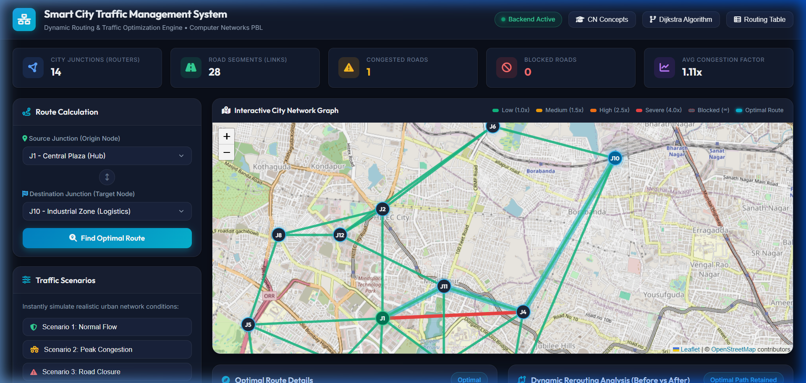
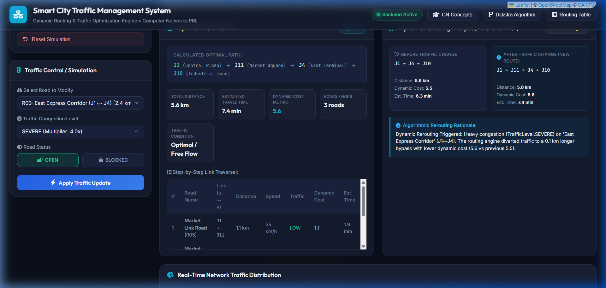
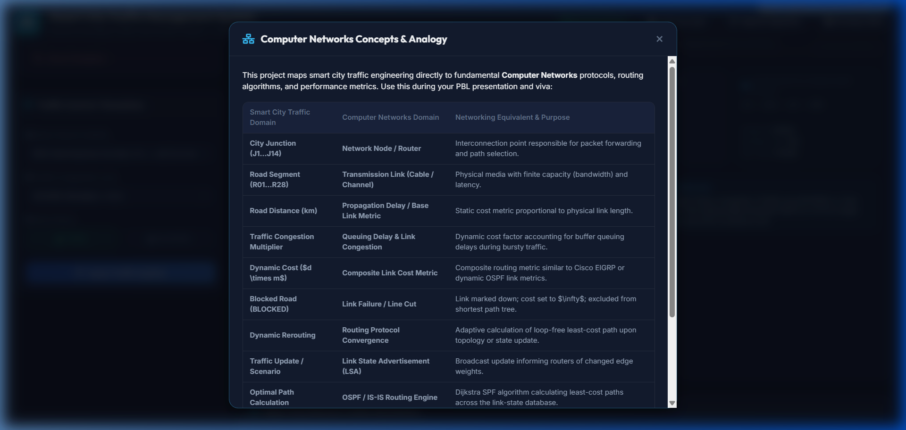
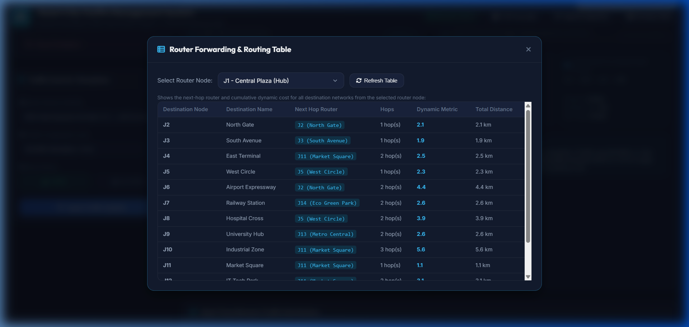

# Smart City Traffic Management System Using Dynamic Routing Algorithms

> **A Computer Networks Project-Based Learning (PBL) System**  
> Developed with Python (FastAPI), Leaflet.js, and Chart.js.

[](https://www.python.org/)
[](https://fastapi.tiangolo.com/)
[]()
[](https://opensource.org/licenses/MIT)

---

## 1. Project Overview

The **Smart City Traffic Management System** is a full-stack, offline-first web application designed for a college Computer Networks Project-Based Learning (PBL) demonstration. It models an urban road grid as a communication network where:

- **Road Intersections** represent **Network Nodes / Routers** ($V = 14$).
- **Road Segments** represent **Transmission Links / Channels** ($E = 28$).
- **Traffic Congestion** represents **Network Queuing Delay & Buffer Sockets** ($1.0\times$ to $4.0\times$).
- **Road Blockages** represent **Link Failures / Line Cuts** ($\text{Cost} = \infty$).
- **Dijkstra’s Shortest Path First (SPF) Algorithm** recalculates least-cost paths dynamically in real time.

When road conditions change due to traffic jams or accidents, the system dynamically reroutes traffic to alternative paths and provides algorithmic before-and-after comparisons explaining the decision.

---

## 2. Visual Dashboard & Screenshots

| **Interactive Network Graph & Dashboard** | **Dynamic Rerouting & Cost Comparison** |
|:---:|:---:|
|  |  |
| **CN Concepts Mapping Modal** | **Router Forwarding & Next-Hop Table** |
|  |  |

---

## 3. Computer Networks Domain Mapping

This project explicitly maps urban traffic engineering to core computer networks topics:

| Smart City Traffic Domain | Computer Networks Domain | Detailed Technical Analogy |
| :--- | :--- | :--- |
| **City Junction ($J_1 \dots J_{14}$)** | **Network Node / Router** | Interconnection entity responsible for packet forwarding and path selection. |
| **Road Segment ($R_{01} \dots R_{28}$)** | **Transmission Link (Cable / Channel)** | Physical medium with finite bandwidth capacity and base latency. |
| **Road Distance ($d$)** | **Propagation Delay / Static Link Metric** | Length-based metric proportional to signal propagation time. |
| **Traffic Congestion Multiplier** | **Queuing Delay / Buffer Congestion** | Added delay when traffic arrival rate exceeds link servicing rate ($\lambda > \mu$). |
| **Dynamic Cost ($d \times \text{multiplier}$)** | **Composite Link Metric** | Adaptive routing metric similar to Cisco EIGRP composite metric or RSVP-TE metric. |
| **Blocked Road (Status: BLOCKED)** | **Link Failure / Interface Down** | Link is marked down; weight set to $\infty$; pruned from Dijkstra relaxation. |
| **Dynamic Rerouting** | **Routing Protocol Convergence** | Re-evaluation of loop-free least-cost paths following a Link State Update. |
| **Traffic Update / Scenario Switch** | **Link State Advertisement (LSA)** | Broadcast notification informing routers about updated edge costs. |
| **Optimal Path Engine** | **OSPF / IS-IS SPF Process** | Local execution of Dijkstra’s Algorithm over the Link State Database (LSDB). |
| **Junction Next-Hop Table** | **Router Forwarding Table (FIB)** | `Destination Node -> Next Hop Router, Metric, Hop Count`. |

---

## 4. Algorithmic Routing Formulation

The core pathfinding engine in `backend/routing.py` implements a manual Dijkstra algorithm with a binary min-heap (`heapq`).

### Dynamic Cost Formula:
$$\text{Cost}(u, v) = \begin{cases} \infty & \text{if } \text{RoadStatus} = \text{BLOCKED} \\ \text{Distance}(u, v) \times \text{Multiplier}(\text{TrafficLevel}) & \text{if } \text{RoadStatus} = \text{OPEN} \end{cases}$$

### Traffic Multipliers:
- **LOW**: $1.0\times$ (Free flow / standard channel transmission)
- **MEDIUM**: $1.5\times$ (Moderate traffic / slight queuing)
- **HIGH**: $2.5\times$ (Heavy congestion / significant buffer backlog)
- **SEVERE**: $4.0\times$ (Severe gridlock / near buffer saturation)

### Algorithmic Complexity:
- **Time Complexity**: $\mathcal{O}((V + E) \log V)$ with min-heap priority queue ($V = 14, E = 28$).
- **Space Complexity**: $\mathcal{O}(V + E)$ for adjacency lists and predecessor maps.

---

## 5. Project Architecture & Directory Structure

```text
CN PBL/
├── backend/                  # FastAPI Application Core
│   ├── __init__.py
│   ├── main.py               # REST API endpoints & static files mount
│   ├── models.py             # Pydantic schemas (Junction, Road, RouteResult, etc.)
│   ├── graph.py              # CityGraph class & adjacency representation
│   ├── routing.py            # Manual Dijkstra routing & comparison logic
│   ├── traffic.py            # TrafficManager: mutations, scenarios & statistics
│   └── data_loader.py        # JSON loaders with validation
├── frontend/                 # Interactive Responsive Dashboard
│   ├── index.html            # Dashboard layout with Leaflet map & modals
│   ├── style.css             # Midnight slate design system & tokens
│   └── app.js                # Map controller, Chart.js & API integrations
├── data/                     # Realistic Urban Network Datasets
│   ├── junctions.json        # 14 smart city junctions with lat/lng
│   ├── roads.json            # 28 bidirectional arterial and collector roads
│   └── scenarios.json        # 3 simulation scenarios (Normal, Peak, Closure)
├── tests/                    # Pytest Comprehensive Test Suite (23 Tests)
│   ├── __init__.py
│   ├── test_routing.py       # Unit tests for Dijkstra SPF, blocked road pruning
│   ├── test_traffic.py       # Unit tests for traffic mutations, reset, scenarios
│   └── test_api.py           # Integration tests for all FastAPI REST endpoints
├── docs/                     # Documentation & Viva Resources
│   ├── VIVA_GUIDE.md         # 15 viva voce Q&As and examiner demo script
│   └── screenshots/          # Saved UI screenshots for report/presentation
├── requirements.txt          # Python dependencies
└── README.md                 # Master project documentation
```

---

## 6. Installation & Quick Start

### Prerequisites
- Python 3.9 or higher installed.
- Git (optional).

### Step 1: Clone or Navigate to Directory
```bash
cd "CN PBL"
```

### Step 2: Create and Activate Virtual Environment (Recommended)
```bash
python -m venv venv

# On Windows (PowerShell):
.\venv\Scripts\Activate.ps1

# On macOS/Linux:
source venv/bin/activate
```

### Step 3: Install Dependencies
```bash
pip install -r requirements.txt
```

### Step 4: Run the Application
```bash
python -m uvicorn backend.main:app --reload --host 127.0.0.1 --port 8000
```

Open your browser and navigate to:
**`http://127.0.0.1:8000`**

---

## 7. REST API Reference

The backend exposes fully typed REST endpoints:

### Route Endpoints
- `POST /api/route`: Calculates optimal path between `source` and `destination`.
  - **Body**: `{"source": "J1", "destination": "J10"}`
  - **Returns**: `RouteCalculationResponse` (optimal path, distance, cost, steps, comparison).

### Traffic Simulation Endpoints
- `POST /api/traffic/update`: Modifies traffic level on a specific road.
  - **Body**: `{"road_id": "R03", "traffic_level": "SEVERE"}`
- `POST /api/road/block`: Sets road status to `BLOCKED` (Cost = $\infty$).
  - **Body**: `{"road_id": "R03"}`
- `POST /api/road/unblock`: Restores road status to `OPEN`.
  - **Body**: `{"road_id": "R03"}`

### Network State & Scenarios
- `GET /api/junctions`: List all 14 junctions with coordinates and descriptions.
- `GET /api/roads`: List all 28 roads with distance, speed limit, traffic level, and status.
- `GET /api/statistics`: Returns network summary metrics (congested count, blocked count, avg multiplier).
- `GET /api/routing-table/{source_id}`: Generates forwarding table entries from `source_id` to all other reachable nodes.
- `POST /api/simulation/scenario`: Applies a predefined scenario (1: Normal, 2: Peak, 3: Closure).
  - **Body**: `{"scenario_id": 2}`
- `POST /api/simulation/reset`: Resets all roads and traffic levels back to default baseline.

---

## 8. Running the Test Suite

Run all automated unit and integration tests using `pytest`:

```bash
pytest -v
```

Expected output:
```text
tests/test_api.py::test_api_get_junctions PASSED
tests/test_api.py::test_api_get_roads PASSED
tests/test_api.py::test_api_route_calculation PASSED
tests/test_api.py::test_api_traffic_update PASSED
tests/test_api.py::test_api_block_road PASSED
tests/test_api.py::test_api_routing_table PASSED
tests/test_api.py::test_api_reset PASSED
tests/test_routing.py::test_dijkstra_baseline_shortest_path PASSED
tests/test_routing.py::test_dijkstra_reroutes_when_traffic_increases PASSED
tests/test_routing.py::test_dijkstra_avoids_blocked_road PASSED
tests/test_traffic.py::test_update_traffic_level PASSED
tests/test_traffic.py::test_block_and_unblock_road PASSED
tests/test_traffic.py::test_apply_scenarios PASSED
tests/test_traffic.py::test_reset_to_baseline PASSED
============================== 23 passed in 0.85s ==============================
```

---

## 9. Viva Voce Highlights & Common Questions

Refer to [`docs/VIVA_GUIDE.md`](docs/VIVA_GUIDE.md) for 15 in-depth question-and-answer pairs and a step-by-step presentation script. Key points include:

1. **Why Dijkstra instead of Bellman-Ford?**  
   Dijkstra has $\mathcal{O}((V + E)\log V)$ complexity on non-negative edge weights and powers standard Link State protocols like OSPF and IS-IS.
2. **What is the significance of the "Next Hop"?**  
   Routers forward packets on a hop-by-hop basis rather than storing full paths in packet headers.
3. **How does traffic relate to queuing delay?**  
   Link length corresponds to propagation delay ($d/s$), while vehicular congestion corresponds to buffer queuing delay ($\lambda / \mu$).

---

## 10. Contributors & License

Developed for Computer Networks PBL Examination.  
Distributed under the MIT License.
